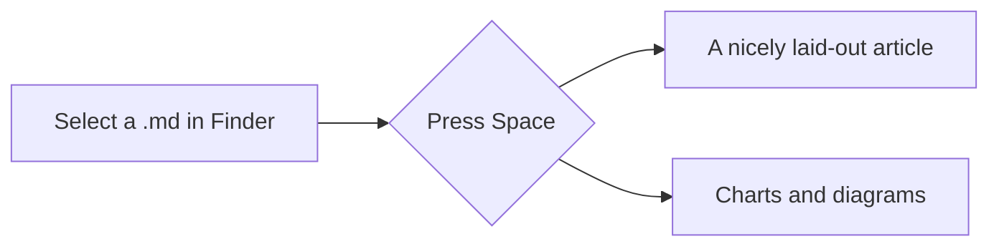

# Welcome to Velmo Viewer

Select any `.md` file in Finder and press **Space** to see it laid out like this.

## What's supported

- **Bold**, *italic*, ~~strikethrough~~, `inline code` and [links](https://velmo.ink)
- [x] Task lists
- [ ] Footnotes[^1], tables and math

> Writing is thinking made visible.

```swift
func greet(_ name: String) -> String {
    return "Hello, \(name)!" // syntax highlighting
}
```

| Shortcut | Action |
| -------- | ------ |
| Space    | Quick Look |
| ⌥ Space  | Full-screen Quick Look |

Inline math $e^{i\pi} + 1 = 0$, and display math:

$$
\int_0^1 x^2\,dx = \frac{1}{3}
$$

ECharts charts, with the option written as JSON in the code block:

```echarts
{
  "tooltip": {},
  "xAxis": { "type": "category", "data": ["Mon", "Tue", "Wed", "Thu", "Fri", "Sat", "Sun"] },
  "yAxis": { "type": "value" },
  "series": [{ "name": "Words", "type": "bar", "data": [820, 1320, 960, 1500, 1100, 600, 300] }]
}
```

Mermaid flowcharts, sequence diagrams and more:



[^1]: Footnotes appear at the end of the document.
