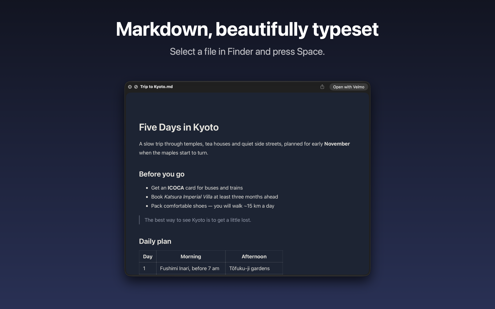
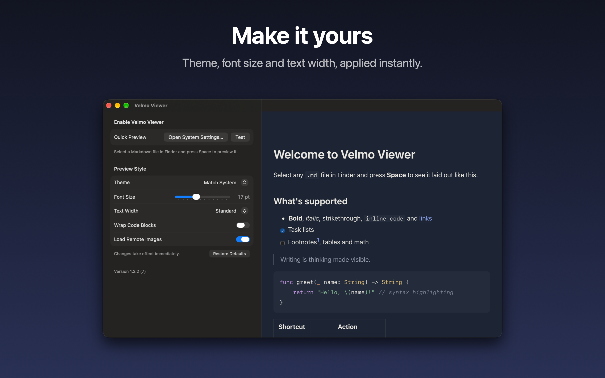
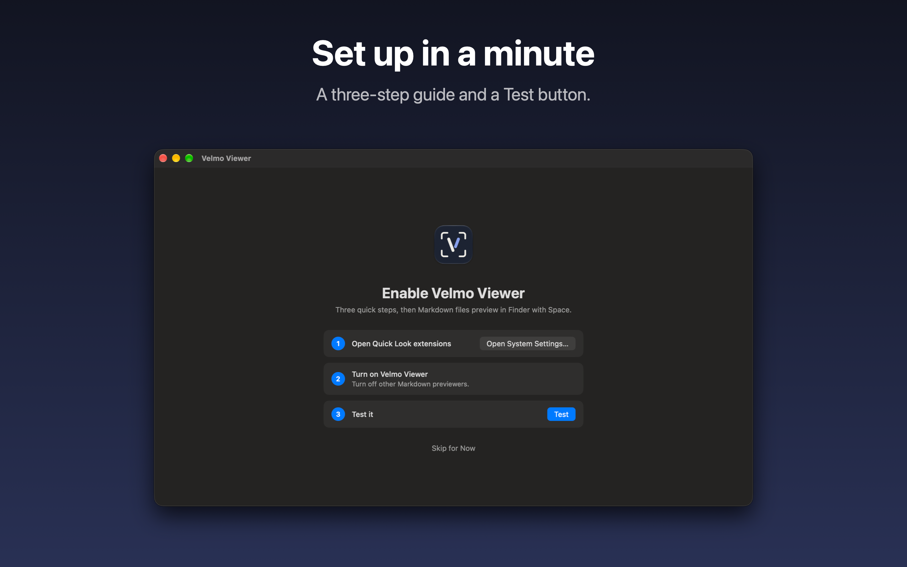

# Velmo Viewer

在 Finder 里选中一个 `.md` 文件，按空格，看到的是一篇排好版的文章，而不是一屏原始文本。

Velmo Viewer 是一个 macOS 快速查看（Quick Look）扩展，外加一个很小的宿主 App，用来引导启用和调整设置。支持 macOS 13 及以上。



## 为什么做它

Markdown 已经是写东西最常用的格式之一：README、笔记、会议纪要、设计文档、AI 生成的报告。但在 Mac 上，想*看一眼*一个 `.md` 文件并不顺手：

- 系统自带的快速查看只把它当纯文本，`#`、`**`、`|---|` 全露在外面，表格、公式、图表更是没法看。
- 双击打开要启动一个编辑器，而大多数时候你只是想读，不是想改。
- 现有的一些预览插件要么样式粗糙，要么不支持公式和图表，要么早已不再维护、在新系统上装不上。

我们想要的是：在任何地方选中文件、按一下空格，就能得到和在一个认真设计过的阅读器里一样的效果，看完按空格关掉，什么都不打扰。

## 功能

**能渲染的内容**

- 标题、粗体、斜体、删除线、链接、行内代码
- 任务列表、表格、引用、脚注
- 代码块语法高亮
- LaTeX 数学公式，行内和块级
- ` ```echarts ` 代码块：写 JSON 格式的 ECharts option，画成图表
- ` ```mermaid ` 代码块：流程图、时序图等 Mermaid 支持的图
- 文档旁边的本地图片；可选加载网络图片

**可以调整的**

- 主题：浅色、深色或跟随系统
- 字号、正文宽度
- 代码块长行自动换行
- 是否加载网络图片

设置窗口右侧是实时预览，改动立刻可见，下一次按空格就按新设置显示。

**上手引导**

首次打开会有三步引导，告诉你在系统设置的哪里打开扩展；点「测试」，App 会弹出一个快速查看面板并确认扩展是否真的生效。

| 设置与实时预览 | 首次启动引导 |
| --- | --- |
|  |  |

## 特色

- **所见即所得的一致性**：设置页里的实时预览和按空格出来的预览用的是同一个渲染器、同一套样式，不存在「设置里好看、实际不一样」。
- **完全本地，不收集任何数据**：所有渲染都在你的 Mac 上完成，不上传文件，没有统计和埋点。唯一的网络访问是你主动打开「加载网络图片」后，按文档里的地址取图。
- **默认安全**：预览的可能是任何来源的文件，所以渲染页禁止文档里的脚本、事件属性和 `javascript:` 链接执行；ECharts 只认 JSON，不执行函数；Mermaid 使用 strict 安全级别，标签里的 HTML 会被清理。
- **按需加载**：ECharts 和 Mermaid 体积不小，只有文档里真的出现对应代码块时才加载，普通文档打开很快。
- **全程沙盒**：App 和扩展都启用了 App Sandbox，没有用私有 API，可以上 Mac App Store。
- **多语言**：界面和示例文档提供英文、简体中文、繁体中文、日文、韩文。

## 背后的思考

**快速查看是最好的阅读入口。** 读文档这件事发生在 Finder 里、在下载文件夹里、在别人发来的压缩包里。与其做一个需要「打开」的阅读器，不如把阅读能力放进系统已有的那个动作：空格。所以产品的主体是扩展，App 只是它的设置页和说明书。

**App 只做必要的事。** 用户可能装完、设置一次就再也不打开它。所以 App 里没有文件管理、没有编辑、没有账号，只有引导、设置和预览。为了不打扰，它不声明能打开 `.md`，不会抢走你的默认编辑器；也不常驻后台。

**排版是一等公民。** 把 Markdown 转成 HTML 很容易，转成*好读*的文章不容易。字号、行宽、标题层级、代码块和表格的处理，都按长文阅读的标准去调，而不是套一个通用的 GitHub 样式。

**图表和公式属于文档的一部分。** 越来越多的 Markdown 里带着公式、数据和流程图，尤其是技术文档和 AI 生成的报告。如果预览只能显示代码块里的源码，就等于没有预览。但图表能力不能以安全为代价，所以选择了「只认数据、不执行代码」的方式来支持它们。

**诚实地面对系统限制。** macOS 对同一种文件只会选一个快速查看扩展，且由系统决定；扩展的沙盒是只读的。这些限制没法绕开，所以 App 的做法是把它们讲清楚（引导你关掉其他 Markdown 扩展），并提供一个能真正验证结果的「测试」按钮，而不是假装一切正常。

## 获取

- Mac App Store：搜索「Velmo Viewer」
- 官网直装版（含自动更新）：[velmo.md/viewer](https://velmo.md/viewer)

装好后打开一次 App，按引导在「系统设置 → 通用 → 登录项与扩展 → 快速查看」（macOS 13、14 在「隐私与安全性 → 扩展 → 快速查看」）里启用 Velmo Viewer。如果装了其他 Markdown 快速查看扩展，需要把它们关掉，系统只会用其中一个。

## 参与开发

欢迎提 Issue 和 Pull Request：渲染问题、样式改进、新语言、对新系统的适配都很有价值。报告渲染问题时，附上能复现的那段 Markdown 会非常有帮助。

### 环境

- macOS 13+，Xcode（不要求 `xcode-select` 指向它，脚本会找 `/Applications/Xcode.app`）
- [XcodeGen](https://github.com/yonaskolb/XcodeGen)：`brew install xcodegen`。Xcode 工程由 `project.yml` 生成，改了它或增删了源文件都要重新生成

### 构建与运行

```bash
scripts/build.sh install
```

构建后装到 `/Applications` 并打开一次，扩展就注册到系统里了。只构建不安装用 `scripts/build.sh`，产物在 `build.noindex/`（不被 Spotlight 索引，也不会在「应用程序」里多出一份）。

设置共享依赖 App Group，而 App Group 标识带开发团队前缀，所以要用真实证书签名；临时签名也能跑，但设置只在 App 里生效，扩展读不到。如果你不在原团队里，在仓库根目录新建 `Signing.local.xcconfig`（已被 git 忽略），写一行：

```
DEVELOPMENT_TEAM = 你的团队 ID
```

再用自己的证书构建。`scripts/build.sh` 默认找钥匙串里的 Developer ID 证书，只有免费账号的话可以指定开发证书：`APPLE_SIGNING_IDENTITY="Apple Development" scripts/build.sh install`。

### 代码结构

```
App/          宿主 App（SwiftUI）：引导、设置、实时预览、示例文档、图标
QuickLook/    快速查看扩展
  web/        渲染页：quicklook.js/css 是预编译的 Markdown 渲染器（源码不公开，见下方许可证）；
              vv-echarts.js、vv-mermaid.js 负责对应代码块；
              echarts.min.js、mermaid.min.js 是 npm 包的 dist 文件，升级时直接替换
Shared/       两边共用：设置读写（ViewerSettings.swift）、渲染（MarkdownRenderer.swift）、多语言字符串
design/       图标源文件
appstore/     App Store 上架文案和截图
release/      自动更新源 appcast.xml 和各版本更新说明
scripts/      构建和发版脚本（发版流程见 RELEASING.md）
project.yml   XcodeGen 工程描述
```

工程里有两个 App target：`VelmoViewer` 是官网直装版，带 [Sparkle](https://sparkle-project.org) 自动更新（相关代码只在 `DIRECT_DISTRIBUTION` 下编译）；`VelmoViewerAppStore` 交给 App Store 更新，不链接 Sparkle。日常开发用前者即可。

### 几个不太显然的实现细节

- **一个渲染器，两处使用。** `MarkdownRenderer` 用 WKWebView 加载 `QuickLook/web/index.html`。扩展里用它出空格预览，App 里用它做实时预览，App 直接读内嵌扩展包里的 `web/`，不重复打包。
- **设置怎么共享。** App 把设置写到 App Group 容器里的 `settings.json`，扩展每次预览重新读。没用 `UserDefaults(suiteName:)`，因为常驻进程会读到缓存的旧值。
- **扩展不能写文件。** 快速查看扩展的沙盒是只读的，连 App Group 容器也写不了。所以「测试」按钮的判断方式是：扩展出完图发一个 Darwin 通知（`ink.velmo.viewer.previewed`），App 在几秒内收到就算生效。
- **本地资源怎么加载。** 沙盒里的 WKWebView 网页进程读不了任意本地文件，所以渲染页和文档旁边的图片都走自定义 scheme `vv-asset://`，由宿主进程读出来再交给网页。
- **只改样式不重渲染。** 改字号、宽度、主题时，直接替换页面里的覆盖样式；只有切换网络图片这类会影响加载的设置才重新渲染。

### 调试提示

- 系统里有多个 Markdown 快速查看扩展时，用哪个由系统决定。调试前先在系统设置里把其他的关掉，否则你看到的可能根本不是自己的构建。
- `qlmanage -r` 可以重置快速查看缓存，`qlmanage -p 文件.md` 可以在命令行直接弹出预览。
- 快速查看面板右上角「用 X 打开」显示的是 `.md` 的默认应用，和是哪个扩展出的预览无关。

## 许可证

除下面两点外，本仓库按 [Apache License 2.0](LICENSE) 发布：

- `QuickLook/web/quicklook.js` 和 `quicklook.css` 是预编译的渲染器，源码不公开，不在 Apache-2.0 授权范围内，可以原样随构建产物再分发。
- 「Velmo」「Velmo Viewer」名称和图标不随许可证授权。欢迎 fork，但分发修改版请换名字和图标。

第三方库的许可证见 [THIRD_PARTY_NOTICES.md](THIRD_PARTY_NOTICES.md)。
