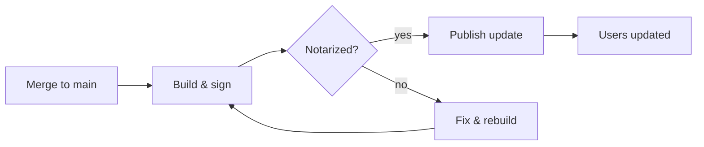

# Release Process

Every release goes through the same four stages. Nothing ships without a signed, notarized build.



## Build

```swift
let release = try await Builder(target: .universal)
    .sign(identity: "Developer ID Application")
    .notarize()
print("Ready: \(release.version)")
```

## Rollback

If a release has a serious bug, publish a fixed build with a **higher build number**[^1].

[^1]: Sparkle compares build numbers, not version strings.
